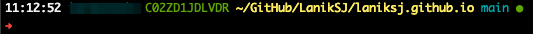

# 🎨 LanikSJ ZSH Theme


## 📑 Table of Contents

- [📝 Description](#-description)
- [📸 Screenshot](#-screenshot)
- [⚡ Install](#-install)
- [🐳 K8s Support](#-k8s-support)
  - [📦 Requirements](#-requirements)
  - [✅ Enable](#-enable)
  - [🚫 Disable](#-disable)
- [🐛 Bugs](#-bugs)
- [📝 License](#-license)
- [💰 Donate](#-donate)

## 📝 Description

[](https://github.com/LanikSJ/laniksj-zsh-theme/actions/workflows/test-zsh-theme.yml)

ZSH Theme based on the great [ys theme](http://ysmood.org/wp/2013/03/my-ys-terminal-theme/),
[Honukai ZSH Theme](https://github.com/oskarkrawczyk/honukai-iterm-zsh) and
[K8s Prompt](https://github.com/jonmosco/kube-ps1)

## 📸 Screenshot



## ⚡ Install

For Oh My ZSH:

```bash
git clone --depth=1 https://github.com/LanikSJ/laniksj-zsh-theme.git ${ZSH_CUSTOM:-$HOME/.oh-my-zsh/custom}/themes/laniksj-zsh-theme
```

or

```bash
git clone --depth=1 git@github.com:LanikSJ/laniksj-zsh-theme.git ${ZSH_CUSTOM:-$HOME/.oh-my-zsh/custom}/themes/laniksj-zsh-theme
```

Set `ZSH_THEME="laniksj-zsh-theme/laniksj"` in `~/.zshrc` to activate.

or using [zinit](https://github.com/zdharma-continuum/zinit)

```bash
zinit light laniksj/laniksj-zsh-theme
```

A reload of your SHELL is **required** for any changes to take affect.

- `source ~/.zshrc`
- `omz reload`
- `exec zsh`

## 🐳 K8s Support

### 📦 Requirements

- [kubectl](https://formulae.brew.sh/formula/kubernetes-cli)
- [kubectx](https://formulae.brew.sh/formula/kubectx)
- [kubens](https://formulae.brew.sh/formula/kubectx)

Install dependencies with 🍻 [Homebrew](https://brew.sh):

```bash
brew install kubectx
```

### ✅ Enable

- Setting a variable `export KUBE-PS1-ENABLED=on` in `~/.zshrc` to activate.
- Using `kubeon` command in your CLI.

### 🚫 Disable

- Setting a variable `export KUBE-PS1-ENABLED=off` in `~/.zshrc` to activate.
- Using `kubeoff` command in your CLI.

## 🐛 Bugs

Please report any bugs or issues you find. Thanks!

## ⚙️ Skills Automation

This repository maintains agent skills via `skills-lock.json`. The GitHub Actions
workflow automatically updates the skills monthly and creates a pull request.

- **Workflow**: `.github/workflows/skills-update.yml`
- **Schedule**: Monthly on the 8th at 03:00 UTC
- **Manual run**: `npx skills update`

## 📝 License

[](https://en.wikipedia.org/wiki/MIT_License)

## 💰 Donate

[](https://www.patreon.com/laniksj/overview)
